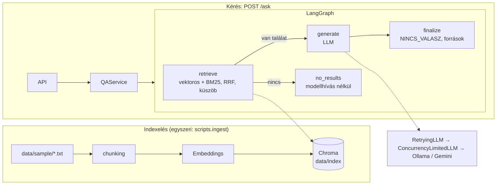

# ekm-rag: kérdés-válasz az épületek energetikai követelményeiről

Python backend alkalmazás, amely a **9/2023. (V. 25.) ÉKM rendelet** (az épületek energetikai jellemzőinek meghatározásáról) szövegére épülő kérdés-válasz (RAG) funkciót ad HTTP API-n keresztül. A kérdésfeldolgozás egy LangGraph-gráf, a modell- és a tárolóintegrációk konfigurációval cserélhetők. Az **ingyenes lokális mód (Ollama)** fizetős kulcs nélkül, az embeddinggel együtt fut, a **felhős mód** Google Geminit használ.

**Tartalom:** [1. Probléma](#1-a-probléma-és-a-célfelhasználó) · [2. Funkciók](#2-megvalósított-funkciók-és-a-prototípus-határai) · [3. Adatforrás](#3-adatforrás-és-adat-előkészítés) · [4. Architektúra](#4-architektúra) · [5. Telepítés](#5-telepítés-és-indítás) · [6. API](#6-api-és-mintakérések) · [7. Modellek](#7-modellkonfiguráció) · [8. Konkurencia](#8-konkurens-felhasználók-és-skálázás) · [9. Tesztek](#9-tesztelés) · [10. Korlátok](#10-ismert-korlátok-és-következő-lépések)

---

## 1. A probléma és a célfelhasználó

**Célfelhasználó:** épületgépész tervező, kivitelező, energetikai tanúsító, aki a rendelet követelményeit keresi.

A rendelet hosszú, sok mellékletet és táblázatot tartalmaz, a kérdések viszont rövidek és konkrétak („Mekkora a homlokzati fal megengedett hőátbocsátási tényezője?”, „Kell-e elektromos töltőpont egy 12 parkolóhelyes irodaépülethez?”). Az alkalmazás megkeresi a releváns bekezdéseket és mellékletpontokat, ezek alapján röviden válaszol, és **megmutatja, melyik §-ra vagy mellékletpontra támaszkodott**, így a válasz az eredeti szövegben ellenőrizhető.

> A válaszok tájékoztató jellegűek, nem helyettesítik a jogszabály eredeti szövegét, a jogi vagy a szakmai tanácsadást.

## 2. Megvalósított funkciók és a prototípus határai

- `POST /ask`: kérdés → hibrid visszakeresés → válaszgenerálás, a felhasznált források listájával
-  `GET /health`
- Bemenetellenőrzés, egységes hibaválasz formátum, naplózás kérés azonosítóval.
- Nincs releváns találat: ha egyetlen találat sem éri el a hasonlósági küszöböt (similarity threshold, `MIN_SCORE`), **modellhívás nélkül** `answered=false`, ha a modell jelzi, hogy a részletekből nem válaszolható meg, szintén `answered=false`.
- Modellhiba, időtúllépés, API limit, túlterhelés külön hibakóddal, átmeneti hibák újrapróbálása, egyidejű modellhívások és a várakozósor korlátozása.
- Két futtatási mód (lokális Ollama / felhős Gemini) **csak konfigurációval** váltva továbbá fake szolgáltatók a tesztekhez.
- Indexelés külön paranccsal (`scripts.ingest`), Dockerfile, docker-compose, rögzített függőségek (`uv.lock`).

**Szándékosan nincs benne:** feltöltési API, beszélgetési előzmény, autentikáció, frontend, streaming, hivatkozásellenőrzés, RAG minőségmérés. A `sources` a modellnek átadott részleteket jelenti, nem ellenőrzött hivatkozást.

## 3. Adatforrás és adat előkészítés

- **Forrás:** [9/2023. (V. 25.) ÉKM rendelet](https://njt.jog.gov.hu/jogszabaly/2023-9-20-8X), Nemzeti Jogszabálytár (hivatalos, ingyenes), **2023.11.02.** időállapot. A jogszabály szövege nem áll szerzői jogi védelem alatt, bizalmas adat nincs benne.
- **Mintaadat a repóban:** [data/sample/9_2023_ekm.txt](data/sample/9_2023_ekm.txt) (megtisztított szöveg, 68 ezer karakter), így saját dokumentum nélkül is kipróbálható.
- **Hiányzik:** a **2., 3. és 8. melléklet** (az oldalon csak PDF-ként érhető el) és a **képletek** (képek - helyükön jelölő szerepel).

**Előkészítés újra** (kihagyható, a kész szöveg a repóban van):

1. Mentsd le az oldalt böngészőből („Weboldal, csak HTML”) ide: `data/raw/9_2023_ekm.html`.
2. `uv run python scripts/clean_html.py data/raw/9_2023_ekm.html data/sample/9_2023_ekm.txt` (HTML → tiszta szöveg, a táblázatok soronként, `|` elválasztóval).
3. Ellenőrzés: `uv run python -m scripts.show_chunks`.

**Chunkolás** ([app/rag/chunking.py](app/rag/chunking.py)): a jogszabály szerkezetét követi, **247 chunk** (85–1638 karakter). Egy chunk egy bekezdés (pl. `3. § (3) bekezdés`), a fogalommeghatározások (2. §) pontonként, a mellékletek számozott pontonként, a táblázat a pontjával együtt. A rövid címsor-pontok az első alpontjukhoz tapadnak (`1.` → `1.1.`), a testvérpontok külön maradnak. Minden chunk elején és metaadatában (`hely`) ott a forrásmegjelölés. Az 1800 karakternél hosszabb egységek részekre bomlanak (`(1/2. rész)`). *Indoklás:* így a hivatkozás § és bekezdés szintű, a fix hosszúságú darabolás pedig mondatokat és táblázatokat vágna ketté.

## 4. Architektúra

```
app/
  main.py            # FastAPI alkalmazás, lifespan (egyszeri inicializálás), kérés azonosító middleware
  api/               # HTTP réteg: végpontok, hibakezelők
  services/          # alkalmazáslogika: bemenet ellenőrzés, a gráf futtatása
  rag/               # chunkolás, hibrid visszakeresés (vektoros + BM25), LangGraph gráf, prompt
  integrations/      # interfészek (Protocol) + implementációk + factory
    llm/             #   ollama, gemini, fake + limiting.py (konkurencia limit, sorlimit, retry)
    embeddings/      #   ollama, gemini, fake
    vectorstore/     #   chroma (perzisztens), memory (tesztekhez)
  container.py       # összekötés (composition root)
  config.py          # minden beállítás egy helyen
  domain.py, errors.py
scripts/             # clean_html, show_chunks, ingest, check_providers, probe_scores, ask, load_probe, eval_questions
tests/               # alaptesztek fake komponensekkel + tests/integration (valódi szolgáltatók)
```

**Függőségi irány:** API → service → gráf → interfészek (`LLM`, `Embeddings`, `VectorStore`). **Szolgáltatóspecifikus kód csak az `app/integrations/` alatt van**, a szolgáltatói hibák is ott fordítódnak saját hibatípusokra. Új szolgáltató = egy új osztály + egy ág a `factory.py`-ban.



1. **retrieve** ([retrieval.py](app/rag/retrieval.py)): vektoros keresés (top 20, a `MIN_SCORE` alattiak eldobva) és BM25 magyar szótövezéssel (top 20), összefésülés Reciprocal Rank Fusionnel, a top 4 kerül a promptba. Ha egyetlen vektoros találat sem éri el a `MIN_SCORE`-t, nincs találat.
2. **no_results:** rögzített válasz, `answered=false`, nincs modellhívás.
3. **generate:** rendszerutasítás + számozott részletek + kérdés. A prompt a részletekre korlátoz, hivatkozást kér, és a részleteket adatként kezelteti (prompt injection ellen).
4. **finalize:** `NINCS_VALASZ` jelzésre `answered=false`, egyébként `sources` (hely, pontszám, kivonat).

### Fő tervezési döntések

| Döntés | Miért | Ára |
|---|---|---|
| Saját `Protocol` interfészek + factory a LangChain-integrációk helyett | Kevés, átlátható kód; tesztben könnyen cserélhető; a hibák egy helyen fordítódnak | Szolgáltatónként saját klienskód, ami a LangChainben kész (pl. streaming), azt meg kell írni |
| LangGraph gráf feltételes éllel | A „nincs találat” ág modellhívás nélkül zárul, bővíthető (átfogalmazás, reranking) | A mostani négy lépéshez egy függvény is elég lenne |
| Chroma, fájlban perzisztens | Nincs külön szerver, 247 elemhez bőven elég | Egy folyamathoz köt (8., 10.) |
| Az index neve tartalmazza az embeddingmodellt (`ekm_ollama_bge_m3`) | Embedding váltáskor nem keverednek inkompatibilis vektorok | A régi kollekciókat kézzel kell törölni, a `MIN_SCORE`-t külön kell állítani |
| LLM és embedding külön váltható | LLM-váltáshoz nem kell újraindexelni | Két beállítást kell összhangban tartani |
| Hibrid keresés (vektoros + BM25, RRF) | A vektoros keresés a jelentést, a BM25 a pontos számokat és kifejezéseket („0,24”, „töltőpont”) fogja meg, az RRF-nek nem kell a két skálát összemérnie | Még egy embeddingfüggő küszöb (`KEYWORD_MIN_SCORE`), a BM25-index memóriában épül, az első kérésnél |
| Hasonlósági küszöb (`MIN_SCORE`) | A nem releváns kérdések modellhívás nélkül zárulnak | Embeddingfüggő, kis mintán kalibrált |
| `NINCS_VALASZ` jelzőszó | Gépileg felismerhető „nem tudom” | A modell engedelmességén múlik (a 4B-s modell néha kitér, 7.2) |
| Lokális embedding CPU-n | Az LLM és az embedding együtt nem fér 4 GB VRAM-ba | Lassabb indexelés és kérdésbeágyazás |

**Küszöb kalibrálás** (`scripts.probe_scores`): `bge-m3`-mal a releváns kérdések legjobb találata 0,673–0,739, a nem relevánsaké 0,352–0,452, ezért `MIN_SCORE=0.55`.

## 5. Telepítés és indítás

**Követelmények:** Python 3.11+, [uv](https://docs.astral.sh/uv/) 0.13+, Git; lokális módhoz [Ollama](https://ollama.com); konténerhez Docker (Compose v2.24+).

### 5.1. Lokálisan (ingyenes, Ollama)

```bash
git clone https://github.com/jamborzsanett/ekm-rag.git
cd ekm-rag
uv sync                         # függőségek az uv.lock alapján
cp .env.example .env            # Windows: copy .env.example .env   (alapból ollama mód)

ollama pull bge-m3              # embedding
ollama pull gemma3:4b           # LLM

uv run python -m scripts.check_providers   # elérhető-e az LLM és az embedding
uv run python -m scripts.ingest            # index építése (egyszer, kb. 2 perc)
uv run uvicorn app.main:app --port 8000    # API indítása
```

Ezután: `http://localhost:8000/docs`, vagy a [6. fejezet](#6-api-és-mintakérések) kérései. API nélkül: `uv run python -m scripts.ask "Mit jelent a jelentős felújítás?"`.

### 5.2. Docker

**a) Az Ollama a gépen fut** (Windows/macOS, ajánlott, mert így a GPU elérhető):

```bash
cp .env.example .env
docker compose up --build -d        # előbb indexel (első indításkor kb. 2 perc), utána indul az API
curl http://localhost:8000/health
```

**b) Az Ollama is konténerben fut** (pl. Linux szerver):

```bash
export OLLAMA_URL=http://ollama:11434        # PowerShell: $env:OLLAMA_URL="http://ollama:11434"
docker compose --profile ollama up --build -d   # modellletöltés (kb. 4,5 GB) → indexelés → API
```

GPU nélkül CPU-n fut (lassabb); NVIDIA GPU-hoz a `docker-compose.yml` kommentje mutatja a beállítást.

**Hogyan működik:** az egyszer lefutó `ingest` szolgáltatás felépíti az indexet az `index` kötetbe, ha még nincs (`--if-empty`), az `api` csak ennek sikere után indul. A b) módban előtte az `ollama-pull` letölti a modelleket. A konténerből a gépen futó Ollama a `host.docker.internal` címen érhető el (Linuxon ehhez `OLLAMA_HOST=0.0.0.0` kell). Az image nem root felhasználóval fut, a `.env` nem kerül bele, a beépített healthcheck a `/health`-et hívja.

**Újraindexelés** (ha változott a szöveg, a chunkolás vagy az embedding):

```bash
docker compose run --rm ingest python -m scripts.ingest   # --if-empty nélkül mindig újraépít
docker compose restart api                                # a futó API nem látja az új indexet (10.)
```

## 6. API és mintakérések

| Végpont | Leírás |
|---|---|
| `POST /ask` | `{"question": "..."}` → `{answer, answered, sources[], request_id}` |
| `GET /health` | `200 ok` / `503 degraded` (üres vagy elérhetetlen index) a modellt szándékosan nem hívja |
| `GET /docs` | Swagger UI példakérésekkel |

Mintakérések: [examples/requests.http](examples/requests.http) és JSON törzsek az [examples/](examples/) mappában (`ask_wall`, `ask_charger`, `ask_irrelevant`, `ask_empty`). Windowson az ékezetek miatt fájlból érdemes küldeni:

```bash
curl -X POST http://localhost:8000/ask -H "Content-Type: application/json" --data-binary @examples/ask_wall.json
```

```json
{
  "answer": "0,24 W/m2K (1. melléklet 1.1. pont).",
  "answered": true,
  "sources": [{"id": "chunk-...", "hely": "1. melléklet 1.1. pont (1/2. rész)", "score": 0.739, "excerpt": "..."}],
  "request_id": "c872bc4c9718"
}
```

Minden hiba ugyanabban a formában jön, a `request_id` a naplóban és az `X-Request-ID` fejlécben is szerepel:

```json
{"error": {"code": "invalid_question", "message": "A kérdés nem lehet üres.", "request_id": "cfca932c0b15"}}
```

| Helyzet | HTTP | `code` |
|---|---|---|
| Üres / csak szóköz / túl hosszú kérdés | 422 | `invalid_question` |
| Hiányzó mező, rossz típus, hibás JSON | 422 | `invalid_request` |
| Nincs releváns találat / a modell nem tud válaszolni | 200 | – (`answered: false`) |
| Modell- / embedding hiba | 502 | `llm_error` / `embedding_error` |
| Szolgáltatói API limit (újrapróbálás után is) | 503 + `Retry-After` | `llm_rate_limited` / `embedding_rate_limited` |
| Megtelt a várakozósor, vagy túl sokáig várt | 503 + `Retry-After` | `overloaded` |
| Időtúllépés (`LLM_TIMEOUT_S`) | 504 | `llm_timeout` / `embedding_timeout` |
| Váratlan hiba (részletek csak a naplóban) | 500 | `internal_error` |

A naplósorok a kérés azonosítóval kezdődnek, a kérdés szövegét nem naplózom, csak a hosszát.

## 7. Modellkonfiguráció

A váltás **csak a `.env`-ben** történik, a kód nem változik:

| Mód | `LLM_PROVIDER` | `EMBEDDING_PROVIDER` | Kulcs |
|---|---|---|---|
| Felhős (elsődleges) | `gemini` | `gemini` | `GEMINI_API_KEY` |
| Lokális, ingyenes | `ollama` | `ollama` | nem kell |
| Tesztek | `fake` | `fake` | nem kell |

Embedding-váltás után újra kell indexelni (`scripts.ingest`, új kollekcióba ír) és a küszöböt állítani (`scripts.probe_scores`). LLM-váltáshoz elég az API újraindítása.

### 7.1. Elsődleges: Google Gemini (felhős)

1. Kulcs a [Google AI Studióban](https://aistudio.google.com/apikey) (az ingyenes szint számlázási adat nélkül igényelhető).
2. `.env`:
   ```
   LLM_PROVIDER=gemini
   EMBEDDING_PROVIDER=gemini
   GEMINI_API_KEY=...
   GEMINI_LLM_MODEL=gemini-3.5-flash
   GEMINI_EMBEDDING_MODEL=gemini-embedding-001
   GEMINI_THINKING_LEVEL=low
   MIN_SCORE=0.70
   KEYWORD_MIN_SCORE=0.65
   LLM_MAX_CONCURRENCY=2
   ```
3. `uv run python -m scripts.check_providers`, `uv run python -m scripts.ingest` (kb. 3 perc), majd az API indítása (5.1 utolsó sora, vagy `docker compose up --build -d`).

**Modellválasztás:**

- **`gemini-3.5-flash`:** gyors, olcsó, jól kezeli a magyart, rövid, kontextusra korlátozott válaszhoz nem kell Pro-modell. A modellnév rögzített, hogy a viselkedés ne változzon a háttérben.
- **`GEMINI_THINKING_LEVEL=low`:** a 3.x modellek válasz előtt belső „gondolkodó” szöveget generálnak. A `low` szint egy egymondatos válasz előtt 685 helyett 450-re csökkenti a gondolkodó tokenek számát, érezhető minőségromlás nélkül. Az első mérésnél (2026.11.16.) ez 17,4 s helyett 4,7 s volt. 2026.11.17–18-án viszont a `gemini-3.5-flash` mindkét szinten kb. 14–17 s alatt válaszolt, a `gemini-3.5-flash-lite` 1–4 s alatt. A válaszidő tehát a szolgáltató pillanatnyi terhelésétől is erősen függ.
- **`gemini-embedding-001`:** többnyelvű, 3072 dimenziós, külön feladattípussal dokumentumra és kérdésre, ugyanaz a kulcs elég hozzá.

**Küszöbök:** a Gemini pontszámai magasabbak (releváns 0,746–0,801, nem releváns 0,602–0,658), ezért `MIN_SCORE=0.70`. A `KEYWORD_MIN_SCORE=0.65` 17 kérdésen kalibrálva: ez még átengedi a hasznos, csak BM25-tel talált fogalmat (0,69), de kiszűri a 0,62–0,64 körüli zajt.

Lassú modellnél a `LLM_QUEUE_TIMEOUT_S=30` és a `LLM_TIMEOUT_S=60` már 5 egyidejű kérésnél is elutasításhoz vezet. Ilyenkor a `GEMINI_LLM_MODEL=gemini-3.5-flash-lite` (kódváltoztatás nélkül) vagy a két időkorlát emelése segít.

**API-limitek:** az ingyenes szinten az embedding percenként kb. 100 szövegre korlátos, ezért indexeléskor a 429-es válasznál a kliens kivárja a Google által javasolt időt ([gemini.py](app/integrations/embeddings/gemini.py)); élő kérdésnél nem vár, hanem 503-at ad. A `gemini-3.5-flash`-hoz naponta kb. **20 kérés** jár, az újrapróbálás is beleszámít. *Adatvédelem:* az ingyenes szinten küldött adatot a Google felhasználhatja, ezért bizalmas adatot ne küldj (a rendelet nyilvános).

**Minőség:** a próbakérdésekre helyes válaszok, pontos hivatkozással, a tudásbázison kívüli kérdésnél a Gemini betartotta a `NINCS_VALASZ` jelzést (9.1).

### 7.2. Ingyenes lokális alternatíva: Ollama

Semmilyen fizetős kulcs nem kell, **az embedding is lokálisan fut**.

1. Telepítsd az Ollamát (<https://ollama.com/download>), vagy használd a compose `ollama` profilját (5.2 b). A natív telepítés háttérszolgáltatásként fut (`http://localhost:11434`), egyébként `ollama serve`.
2. Modellek (egyszer, internet kell):
   ```
   ollama pull bge-m3        # többnyelvű embedding, 1024 dimenzió, kb. 1,2 GB
   ollama pull gemma3:4b     # LLM, 4-bites kvantált, kb. 3,3 GB
   ```
3. `.env` (ez az `.env.example` alapértelmezése):
   ```
   LLM_PROVIDER=ollama
   EMBEDDING_PROVIDER=ollama
   OLLAMA_BASE_URL=http://localhost:11434
   OLLAMA_LLM_MODEL=gemma3:4b
   OLLAMA_EMBEDDING_MODEL=bge-m3
   OLLAMA_EMBEDDING_ON_CPU=true
   LLM_MAX_CONCURRENCY=1
   ```
4. `uv run python -m scripts.check_providers`, `uv run python -m scripts.ingest`, majd az API indítása (5.1 vagy 5.2).

**Modellválasztás:** a `bge-m3` többnyelvű, magyar jogszabályszövegen megbízhatóbb az angolra optimalizált modelleknél. A `gemma3:4b` befér egy 4 GB-os GPU-ba, és elfogadhatóan kezeli a magyart; nagyobb géphez `OLLAMA_LLM_MODEL=gemma3:12b` jobb minőséget ad.

**Hardverigény (becslés):** minimum 8 GB RAM (ekkor minden CPU-n fut, többszörös válaszidővel), ajánlott 16 GB RAM és 4 GB+ VRAM, kb. 5 GB lemez a modelleknek, plusz 1,6 GB a Docker image-nek.

**Mért adatok** (Ryzen 5 5600H, 16 GB RAM, RTX 3050 4 GB, Windows; egyszeri mérések):

| Mérés | Eredmény |
|---|---|
| Indexépítés (`bge-m3` CPU-n) | kb. 110–130 s (konténerből is) |
| Kérdés, nincs releváns találat | 0,7–3 s |
| Kérdés-válasz, betöltött modellel | 4–18 s |
| Első kérdés (modellbetöltéssel) | kb. 29 s |
| 5 egyidejű kérdés, `LLM_MAX_CONCURRENCY=1` | mind sikeres, egymás után futnak, az utolsó 20,2 s |

**Korlátok:** gyengébb válaszminőség (néha pontatlan §-hivatkozás, miközben a `sources` helyes). A „nem tudom” jelzés nem megbízható (a tudásbázison kívüli kérdésre kitérő választ ad) lassabb, egy GPU-n egyszerre egy generálás hatékony.

## 8. Konkurens felhasználók és skálázás

A rendszer egy példányban több egyidejű felhasználóval helyesen működik, a korlát a modell áteresztőképessége.

**Kérések elkülönítése (megvalósítva):** a komponensek induláskor egyszer jönnek létre, és nincs bennük kérésenként módosuló állapot. Minden kérés saját gráfállapotot kap, a domain-típusok módosíthatatlanok (`frozen=True`), a kérés azonosító `contextvars`-ban van. Teszt: `test_parallel_requests_do_not_mix_results`.

**Párhuzamosság (megvalósítva):** a teljes kérésút aszinkron (`httpx.AsyncClient`, a Gemini SDK aszinkron kliense, async gráfcsomópontok). A szinkron Chroma hívásai `asyncio.to_thread`-ben futnak. A CPU-igényes munka az Ollama külön folyamatában fut, az indexelés pedig külön parancs, így az API-nak elég egy worker.

**Erőforráskorlátok (megvalósítva, [limiting.py](app/integrations/llm/limiting.py)):**

- **Egyidejűség:** `asyncio.Semaphore` (`LLM_MAX_CONCURRENCY`; lokálisan 1, felhőben a kulcs limitjéhez igazítva).
- **Túlterhelés:** legfeljebb `LLM_MAX_QUEUE` kérés várhat, legfeljebb `LLM_QUEUE_TIMEOUT_S` ideig; a többi azonnal 503 `overloaded` + `Retry-After`. Így a sor nem nő korlátlanul.
- **Időtúllépés:** `LLM_TIMEOUT_S` minden modell- és embedding-hívásra → 504.
- **Újrapróbálás:** csak 429 és 5xx esetén, exponenciális várakozással; időtúllépésnél nem (megduplázná a válaszidőt). A retry a korlátozón kívül van, így várakozás közben nem foglal modellhelyet.
- **Olcsó elutasítás:** a küszöb alatti kérdések és a hibás bemenet nem jut el a modellig.

Tesztek: `test_concurrency_limit_is_enforced`, `test_overload_is_rejected_when_queue_is_full`, `test_queue_wait_is_time_limited`, `test_retry_*`.

**Több példány:** az API, a service és a gráf állapotmentes, a konfiguráció környezeti változóból jön, a `/health` terheléselosztóhoz is jó. Ami gátolja: a fájlos Chroma egy gépre köt. Ehhez megosztott, szerveres vektortár kell (pgvector, Qdrant vagy Chroma szerver mód), ami egy új `VectorStore` implementáció és egy factory ág. Az indexelés ekkor egy workerben futna, a példányok csak olvasnának. Lokális módban az Ollama külön szolgáltatás, több GPU-s gép elé terheléselosztó tehető.

**Szűk keresztmetszet:** lokálisan a generálás, felhőben az API limit és a szolgáltató késleltetése. Figyelendő metrikák: késleltetés a visszakeresésre és a modellhívásra külön, sorhossz és várakozási idő, 429/timeout/5xx/`overloaded` arány, `answered=false` arány, tokenhasználat.

**Fejlesztési sorrend több felhasználóhoz:**

1. **Mérés:** a fenti metrikák kiadása (pl. Prometheus), hogy látsszon, hol lassú a rendszer.
2. **Közös konkurenciakorlát** (pl. Redis): ma a korlát példányonként érvényes, több példány együtt túlterhelheti a modellt vagy a Gemini keretet.
3. **Válasz cache** az ismétlődő kérdésekre: a leglassabb lépést, a modellhívást spórolja meg.
4. **Streaming (SSE):** nem lesz rövidebb a teljes idő, de a válasz azonnal elkezd megjelenni.
5. **Több API példány** szerveres vektortárral, felhasználónkénti adatoknál minden lekérdezés kötelezően szűr a felhasználóra.
6. **Több modellkapacitás:** több GPU, vagy magasabb felhős keret.

## 9. Tesztelés

```bash
uv run pytest                    # 67 alapteszt: fake LLM/embedding, memóriabeli tár, hálózat és kulcs nélkül (~3 s)
uv run pytest -m integration     # valódi Ollama (ha fut) és Gemini (ha van GEMINI_API_KEY), különben skip
uv run ruff check . && uv run ruff format --check .
```

| Terület | Fájl |
|---|---|
| API: siker forrásokkal, hibás bemenet és JSON → 422, nincs találat → 200 modellhívás nélkül, 502/503/504/500 hibák, 404/405, health, kliensek lezárása | [tests/test_api.py](tests/test_api.py) |
| Service és gráf: `NINCS_VALASZ`, párhuzamos kérések elkülönítése, konkurencia-limit, túlterhelés, retry | [tests/test_qa_flow.py](tests/test_qa_flow.py) |
| Integrációk mockolt HTTP-vel, Gemini `retry in Ns` kiolvasása, valódi Chroma ideiglenes mappában | [tests/test_integrations.py](tests/test_integrations.py) |
| Hibrid keresés: szótövezés, BM25, RRF, zajszűrés, relevancia kapu | [tests/test_retrieval.py](tests/test_retrieval.py) |
| Indexelés (`--if-empty`), kérdéssor épsége, chunkolás, HTML tisztítás, fake komponensek | [tests/](tests/) többi fájlja |
| Teljes folyamat valódi szolgáltatóval | [tests/integration/](tests/integration/test_live_providers.py) |

A tesztek a komponenseket ugyanazon az összekötésen keresztül cserélik (`create_app(settings, components)`, `build_qa_service(...)`), amit az éles alkalmazás használ.

### 9.1. Kérdéssoros próba valódi modellekkel

[examples/eval_questions.json](examples/eval_questions.json): 11 szakmai kérdés, mindegyikhez az elvárt rendeletpont és a válasz kulcskifejezése. Egy kérdés szándékosan a tudásbázison kívülre mutat (2. melléklet, PDF), ott az `answered=false` a helyes.

```bash
uv run python -m scripts.eval_questions --provider ollama
uv run python -m scripts.eval_questions --provider gemini --llm-model gemini-3.5-flash-lite --delay 5 --out eval.json
```

Nem RAG-minőségmérés, hanem gyors, megismételhető ellenőrzés. **Eredmények** (2026.11.18., egyszeri futás, a 247 chunkos indexen):

| | `gemma3:4b` + `bge-m3` | `gemini-3.5-flash-lite` + `gemini-embedding-001` |
|---|---|---|
| A keresés megtalálta a választ tartalmazó pontot (a modellnek átadott 4 részlet között volt) | 10/10, mindig az 1. helyen | 10/10 (8-szor az 1., 2-szer a 2. helyen) |
| A modell válasza helyes (kézi ellenőrzés) | 9/10 (egynél rossz §-hivatkozás) | 10/10 |
| Tudásbázison kívüli kérdés elutasítva | 0/1 | 1/1 |
| Válaszidő | 2–13 s | 1–2,4 s |

A visszakeresés mindkét módban megbízható, a BM25 ezen a kérdéssoron nem javított mérhetően, a pontos számokra vonatkozó kérdéseknél viszont igen. A Gemini részletesebb és pontosabban hivatkozik. 

## 10. Ismert korlátok és következő lépések

**Korlátok, egyszerűsítések**

- A **2., 3. és 8. melléklet** (PDF) és a **képletek** nincsenek a tudásbázisban, a kis lokális modell ezt nem mindig ismeri el.
- Egyetlen jogszabály, egyetlen időállapot (2023.11.02.), a módosítások nincsenek követve.
- A `sources` a modellnek átadott részletek, nem ellenőrzött hivatkozások.
- A küszöb kis mintán kalibrált és embeddingfüggő: szolgáltatóváltáskor a `MIN_SCORE`-t is át kell állítani.
- A `/health` nem ellenőrzi a modellt (szándékosan), erre a `scripts.check_providers` való.
- Nincs autentikáció, felhasználónkénti rate limit és előzmény, a konkurenciakorlát folyamatonként érvényes.
- A Gemini ingyenes szintjén lassú az indexelés, és napi kb. 20 kérés a keret.
- **Újraindexelés futó API mellett:** a Chroma fájlos módja az indexet folyamatonként a memóriában tartja, ezért a külön futtatott `scripts.ingest` után a futó API nem látja az új kollekciót (`/health` 503, `/ask` 500). Megkerülés: indexelés után az API újraindítása, a compose eleve indexel előbb.

**Következő lépések** (a 8. fejezet fejlesztési sorrendjén túl)

1. Verziózott index: az ingest új kollekcióba ír, és atomikusan átállítja az aktívat, így nem kell újraindítani az API-t.
2. A küszöb tárolása az index metaadataként, hogy együtt váltson az embeddinggel.
3. A PDF mellékletek feldolgozása, táblázatok soronkénti chunkolása a fejléc ismétlésével.
4. Reranking többnyelvű cross-encoderrel (pl. `bge-reranker-v2-m3`), § szerinti kérdések közvetlen lekérése metaadat szűréssel.
5. A kérdéssor bővítése és automatikus futtatása prompt-, küszöb- vagy modellváltáskor.
6. Hivatkozás-ellenőrzés: a válaszban említett § valóban szerepel-e a forrásokban.
